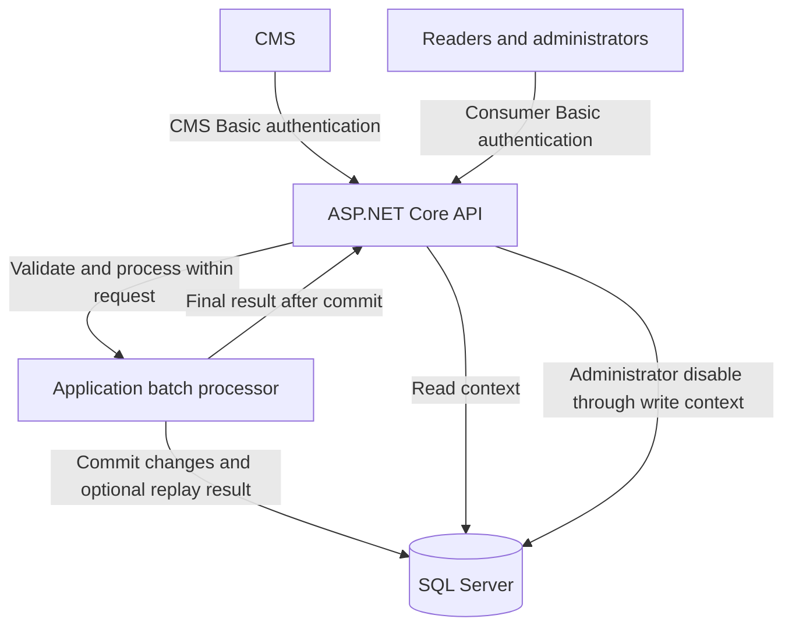

# CMS Event Processor

A .NET service for receiving CMS events, maintaining the latest entity state, and exposing confidential content through an authenticated API.

**Status: design approved; implementation not started.** Application code, runnable setup, tests, CI, and deployment artifacts have not been implemented. This repository does not yet expose any endpoints.

## Start here

| Document | Purpose |
| --- | --- |
| [Assessment brief](docs/assessment/brief.md) | Readable assessment with the employer's requirements preserved |
| [Original assessment](docs/assessment/original.md) | Unmodified source supplied for the challenge |
| [Architecture](docs/architecture.md) | Components, persistence, security, and processing guarantees |
| [API contract](docs/api.md) | Approved endpoint design, authentication, validation, and responses |
| [Authentication and credential setup](#authentication-and-credential-setup) | Account provisioning, configuration, and credential rotation |
| [Architecture decisions](docs/decisions/001-synchronous-processing.md) | Rationale and tradeoffs for the processing approach; access and lifecycle decisions are linked from the architecture |

## Planned stack

- .NET 10 and ASP.NET Core.
- Entity Framework Core 10 and Microsoft SQL Server 2022 Developer for local development.
- Synchronous batch processing with one SQL transaction per request.
- Separate read/write contexts and CMS/consumer authentication policies.
- Unit tests, real SQL Server integration tests, and a Postman acceptance walkthrough.
- Docker for local delivery; an optional temporary HTTPS tunnel for demonstrations.

The assessment permits .NET 9 or above. .NET 10 is our selected LTS target, rather than an alteration to the original requirement. See the [Microsoft support policy](https://dotnet.microsoft.com/en-us/platform/support/policy/dotnet-core).

## Architecture at a glance

The webhook returns `200 OK` with final outcomes only after the batch commits. There is no background worker or status-polling endpoint. Database calls still use `async`/`await`; synchronous processing means the response waits for completion, not that threads block on I/O.

The design prioritizes the difficult cases: unpublished revisions that were never published, delayed events, hard deletion, atomic batches, safe retries after a lost response, and administrator overrides that survive subsequent CMS publishes. Read the [architecture](docs/architecture.md) for the rules and their limitations.

## Planned API

All routes below are **approved design, not implemented**. The [API contract](docs/api.md) contains full behavior and examples.

| Method | Route | Access | Purpose |
| --- | --- | --- | --- |
| POST | `/cms/events` | CMS | Process and commit a batch, returning final outcomes |
| GET | `/api/entities` | Reader or administrator | List entities with role-based visibility |
| GET | `/api/entities/{id}` | Reader or administrator | Read an entity with the same visibility rules |
| PUT | `/api/entities/{id}/disable` | Administrator | Apply a persistent local disable |
| GET | `/health/live` | Administrator | Check process availability |
| GET | `/health/ready` | Administrator | Check database access and expected schema |

## Authentication and credential setup

**This is the approved setup design; the setup utility and authentication code are not implemented yet.** Accounts will be provisioned explicitly during setup, not registered through an API endpoint. No separate authentication service, login/token endpoint, registration flow, or user database is required.

The setup utility will create three preconfigured accounts:

| Account | Permissions |
| --- | --- |
| CMS organization | Submit events and receive their processing results |
| Reader | Read published entities that are not administratively disabled |
| Administrator | Read all retained entities, disable them locally, and access health checks |

For each account, setup will generate a unique username of 10–20 characters and a random GUID password. It will hash the password using an established password-hashing implementation and save the username, hash, authentication scheme, and assigned role/policy in ignored local configuration. The generated plaintext passwords will be displayed once during interactive setup so they can be saved securely and entered into private Postman environments. They will not be saved in application logs or committed files.

At startup, the API will load and validate the configured accounts. It will not create accounts or regenerate passwords automatically. Re-running setup must not silently overwrite accounts or rotate existing credentials.

Every request will send Basic credentials; ASP.NET Core authentication will verify the password against the configured hash, and authorization policies will enforce the permissions above. Roles are configured server-side. An administrator account does not grant CMS ingestion access. External requests require HTTPS because Basic Authentication only Base64-encodes credentials.

In Postman, select **Basic Auth** and supply the appropriate username and password from a private environment. Shared collection/environment templates will contain no credentials.

For deployment, load the same account definitions and password hashes from deployment secrets or environment-provided configuration. To add an account or rotate credentials, explicitly update the configuration and restart the application. A rotation generates and displays a new password, replaces its stored hash, and invalidates the previous password once the new configuration is loaded. There is no password-recovery endpoint; a lost password must be rotated.

See the [access decision](docs/decisions/003-access-and-read-write-boundaries.md) and [API access matrix](docs/api.md#access-matrix) for the authentication boundaries.

## Running and testing

There is no executable application yet. Working setup, migration, and test commands will be added alongside the implementation that makes them valid.

The final quickstart will cover native .NET execution, Docker Compose, generated local credentials, database migrations, and a Postman walkthrough. SQL Server containers require an x86-64 Linux environment; Apple Silicon reviewers will need a remote SQL Server-compatible database for the supported setup path. See [Microsoft's platform guidance](https://learn.microsoft.com/en-us/sql/linux/install-upgrade/setup).

## Delivery

The final submission will include a verified fresh-clone walkthrough and a release tag. Paid hosting is not required: local Docker is the baseline, with a free temporary tunnel as the optional live demo. Azure remains a documented deployment alternative.
