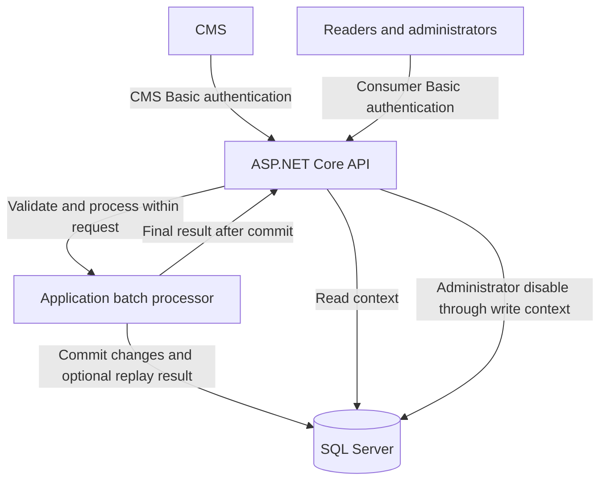

# CMS Event Processor

A .NET service for receiving CMS events, maintaining the latest entity state, and exposing confidential content through an authenticated API.

**Status: service foundation implemented; business processing is pending.** The host, account provisioning, Basic authentication, access policies, safe errors, unit/HTTP integration tests, CI definition, and container build are present. CMS, entity, database, and health endpoints are not implemented yet.

## Start here

| Document | Purpose |
| --- | --- |
| [Assessment brief](docs/assessment/brief.md) | Readable assessment with the employer's requirements preserved |
| [Original assessment](docs/assessment/original.md) | Unmodified source supplied for the challenge |
| [Architecture](docs/architecture.md) | Components, persistence, security, and processing guarantees |
| [API contract](docs/api.md) | Approved endpoint design, authentication, validation, and responses |
| [Authentication and credential setup](#authentication-and-credential-setup) | Account provisioning, configuration, and credential rotation |
| [Development and container setup](docs/development.md) | Configuration precedence, deployment secrets, and HTTPS container execution |
| [Architecture decisions](docs/decisions/001-synchronous-processing.md) | Rationale and tradeoffs for the processing approach; access and lifecycle decisions are linked from the architecture |

## Solution layout

The solution contains one production project and two test projects, all beside the solution file:

```text
cms-event-processor/
  CmsEventProcessor.slnx
  CmsEventProcessor/
    Api/
      Authentication/
        Handlers/
        Options/
      ErrorHandling/
      Provisioning/
    Application/
      Identity/
        Contracts/
        Models/
    Domain/
    Infrastructure/
      Identity/
        Models/
        Options/
        Services/
    Program.cs
  CmsEventProcessor.UnitTests/
  CmsEventProcessor.IntegrationTests/
  docs/
```

The production folders separate responsibilities within a single assembly. Authentication and provisioning share the Application identity contracts and safe results. Infrastructure owns configured account hashes, verification, and file updates. The API adapts those contracts to Basic Authentication and account commands; `Program.cs` connects implementations through dependency injection. The Domain folder is reserved for the upcoming entity rules.

Folder and namespace boundaries are maintained through review rather than separate project references. Tests check that shared identity contract signatures exclude HTTP/storage types and that authentication results contain no stored hashes. See the [identity boundaries](docs/architecture.md#shared-identity-boundaries) for the design rationale.

## Planned stack

- .NET 10 and ASP.NET Core.
- Entity Framework Core 10 and Microsoft SQL Server 2022 Developer for local development.
- Synchronous batch processing with one SQL transaction per request.
- Separate read/write contexts and CMS/consumer authentication policies.
- Unit tests, real SQL Server integration tests, and a Postman acceptance walkthrough.
- Docker for local delivery; an optional temporary HTTPS tunnel for demonstrations.

The assessment permits .NET 9 or above. .NET 10 is our selected LTS target, rather than an alteration to the original requirement. See the [Microsoft support policy](https://dotnet.microsoft.com/en-us/platform/support/policy/dotnet-core).

## Architecture at a glance



The planned webhook returns `200 OK` with final outcomes only after the batch commits. There is no background worker or status-polling endpoint in the design. Database calls will use `async`/`await`; synchronous processing means the response waits for completion, not that threads block on I/O.

The design prioritizes the difficult cases: unpublished revisions that were never published, delayed events, hard deletion, atomic batches, safe retries after a lost response, and administrator overrides that survive subsequent CMS publishes. Read the [architecture](docs/architecture.md) for the rules and their limitations.

## Planned API

All routes below are **approved design, not implemented**. The [API contract](docs/api.md) contains full behavior and examples.

| Method | Route | Access | Purpose |
| --- | --- | --- | --- |
| POST | `/cms/events` | CMS | Process and commit a batch, returning final outcomes |
| GET | `/api/entities` | Reader or administrator | List entities with role-based visibility |
| GET | `/api/entities/{id}` | Reader or administrator | Read an entity with the same visibility rules |
| PUT | `/api/entities/{id}/disable` | Administrator | Apply a persistent local disable |
| GET | `/health/live` | Administrator | Check process availability |
| GET | `/health/ready` | Administrator | Check database access and expected schema |

## Authentication and credential setup

Accounts are provisioned explicitly through the implemented setup command. There is no registration, login/token endpoint, separate authentication service, or user database.

The setup utility creates three preconfigured accounts. Their permissions are enforced by policies, with business endpoints to follow:

| Account | Permissions |
| --- | --- |
| CMS organization | Submit events and receive their processing results |
| Reader | Read published entities that are not administratively disabled |
| Administrator | Read all retained entities, disable them locally, and access health checks |

For each account, setup generates a unique username of 10–20 characters and a random GUID password. It hashes the password using ASP.NET Core Identity's PBKDF2 implementation and saves the username, hash, and account kind in ignored local configuration. The account kind determines the authentication scheme and role/policy. Generated plaintext passwords are displayed once by the setup command so they can be saved securely and entered into private Postman environments. They are not saved in application logs or committed files.

At startup, the API loads and validates the configured accounts. It does not create accounts or regenerate passwords. Re-running initialization refuses to overwrite an existing file; account addition and rotation are explicit commands.

Every protected request sends Basic credentials; ASP.NET Core authentication verifies the password against the configured hash, and authorization policies enforce the permissions above. Roles are configured server-side. An administrator account does not grant CMS ingestion access. External requests require HTTPS because Basic Authentication only Base64-encodes credentials. Development allows HTTP only from a loopback socket peer; forwarded headers cannot bypass that restriction.

In Postman, select **Basic Auth** and supply the appropriate username and password from a private environment. A collection will be added with the business endpoints; shared templates will contain no credentials.

For deployment, load the same account definitions and password hashes from deployment secrets or environment-provided configuration. To add an account or rotate credentials, explicitly update the configuration and restart the application. A rotation generates and displays a new password, replaces its stored hash, and invalidates the previous password once the new configuration is loaded. There is no password-recovery endpoint; a lost password must be rotated.

See the [access decision](docs/decisions/003-access-and-read-write-boundaries.md) and [API access matrix](docs/api.md#access-matrix) for the authentication boundaries.

## Running locally

Install the .NET SDK pinned in [global.json](global.json), currently **10.0.301**. No database or Docker engine is needed for the foundation.

From the repository root:

```sh
dotnet restore CmsEventProcessor.slnx --locked-mode
dotnet build CmsEventProcessor.slnx --configuration Release --no-restore
cd CmsEventProcessor
dotnet run --configuration Release --no-build --no-launch-profile -- accounts init --file appsettings.Local.json
dotnet run --configuration Release --no-build --launch-profile local
```

Save the three generated passwords securely when setup displays them. The local profile listens on `http://127.0.0.1:5080`. Missing or invalid account configuration prevents startup. An unauthenticated request to `/` receives `401`; a valid consumer identity receives `404` because no business routes are mapped yet. Integration tests add protected probe controllers from their own assembly; those routes are never shipped with the application.

Stop the host before editing account configuration. From `CmsEventProcessor`, use either explicit operation and then restart:

```sh
dotnet run --configuration Release --no-build --no-launch-profile -- accounts add --file appsettings.Local.json --kind Reader
dotnet run --configuration Release --no-build --no-launch-profile -- accounts rotate --file appsettings.Local.json --username <existing-username>
```

Replace `<existing-username>` before running the rotation command. Only the newly generated password is displayed. `--kind` accepts `Cms`, `Reader`, or `Admin`.

The [configuration example](docs/examples/authentication.example.json) documents the hash-only file shape; use setup rather than copying placeholder hashes. Local credential files are excluded from both Git and publish output.

## Tests and code conventions

Run from the repository root:

```sh
dotnet format CmsEventProcessor.slnx --verify-no-changes --no-restore
dotnet test CmsEventProcessor.slnx --configuration Release --no-build --no-restore --logger trx --results-directory artifacts/test-results --collect "XPlat Code Coverage"
```

Unit tests cover account generation, hashing, safe file updates, configuration validation, startup snapshots, and identity contract/result boundaries. HTTP integration tests run the actual middleware with isolated credentials and test-only routes, covering scheme/role boundaries, malformed headers, transport security, response/log privacy, missing configuration, and credential rotation after restart. SQL integration tests will arrive with persistence.

Each type has its own file. Types and methods have multiline XML summaries; test summaries state the scenario and expected behavior. Method inputs, returned values, and meaningful propagated exceptions use XML documentation tags. Fields/properties receive notes only for particular constraints or behaviors. XML documentation is generated during builds, and missing public documentation fails the build. CI runs locked restore, formatting, Release build, and tests on Windows and Linux, then builds the container. Hosted CI results are available only after the branch is published.

The final delivery will add SQL migrations, Docker Compose, and a Postman walkthrough. SQL Server containers require an x86-64 Linux environment; Apple Silicon reviewers will need a remote SQL Server-compatible database once persistence is introduced. See [Microsoft's platform guidance](https://learn.microsoft.com/en-us/sql/linux/install-upgrade/setup).

## Delivery

The final submission will include a verified fresh-clone walkthrough and a release tag. Paid hosting is not required: local Docker is the baseline, with a free temporary tunnel as the optional live demo. Azure remains a documented deployment alternative.
