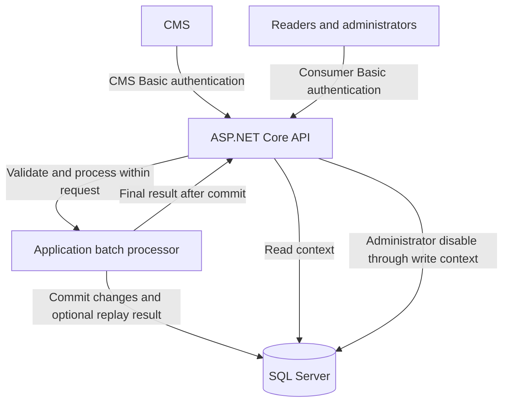

# CMS Event Processor

A .NET service for receiving CMS events, maintaining the latest entity state, and exposing confidential content through an authenticated API.

**Status: authenticated CMS webhook implemented with transactional SQL processing.** `POST /cms/events` validates whole batches and returns final outcomes after commit, with optional scoped replay. Account provisioning, safe errors, generated OpenAPI, an executable Postman ingestion collection, unit/HTTP/SQL tests, CI, and container delivery are present. Consumer and health endpoints remain pending.

## Start here

| Document | Purpose |
| --- | --- |
| [Assessment brief](docs/assessment/brief.md) | Readable assessment with the employer's requirements preserved |
| [Original assessment](docs/assessment/original.md) | Unmodified source supplied for the challenge |
| [Architecture](docs/architecture.md) | Components, persistence, security, and processing guarantees |
| [Domain lifecycle implementation](docs/entity-lifecycle.md) | Implemented state transitions, payload semantics, and unit-test evidence |
| [SQL persistence and processing](docs/persistence.md) | Database setup, explicit migrations, transaction/replay behavior, and real SQL tests |
| [API contract](docs/api.md) | Approved endpoint design, authentication, validation, and responses |
| [Webhook implementation](docs/webhook.md) | Implemented request validation, error mapping, HTTP/SQL tests, and OpenAPI access |
| [Postman ingestion walkthrough](docs/postman/README.md) | Seven executable synthetic requests and an empty-credential environment template |
| [Authentication and credential setup](#authentication-and-credential-setup) | Account provisioning, configuration, and credential rotation |
| [Development and container setup](docs/development.md) | Configuration precedence, deployment secrets, and HTTPS container execution |
| [Architecture decisions](docs/decisions/001-synchronous-processing.md) | Rationale and tradeoffs for the processing approach; access and lifecycle decisions are linked from the architecture |

## Solution layout

The solution contains one production project and two test projects, all beside the solution file:

```text
cms-event-processor/
  CmsEventProcessor.slnx
  CmsEventProcessor/
    Api/
      Cms/
        Controllers/
        Dtos/
        Services/
        Validation/
      Documentation/
      Authentication/
        Handlers/
        Options/
      ErrorHandling/
      Provisioning/
    Application/
      Processing/
      Identity/
        Contracts/
        Models/
    Domain/
      Entities/
        Models/
        Services/
    Infrastructure/
      Persistence/
      Identity/
        Models/
        Options/
        Services/
    Program.cs
  CmsEventProcessor.UnitTests/
  CmsEventProcessor.IntegrationTests/
  docs/
```

The production folders separate responsibilities within a single assembly. Authentication and provisioning share the Application identity contracts and safe results. Infrastructure owns configured account hashes, verification, and file updates. The API adapts those contracts to Basic Authentication and account commands; `Program.cs` connects implementations through dependency injection. Domain owns the pure entity lifecycle rules, immutable snapshots, and content-free deletion markers.

Folder and namespace boundaries are maintained through review rather than separate project references. Tests check that shared identity contract signatures exclude HTTP/storage types and that authentication results contain no stored hashes. See the [identity boundaries](docs/architecture.md#shared-identity-boundaries) for the design rationale.

## Planned stack

- .NET 10 and ASP.NET Core.
- Entity Framework Core 10 and Microsoft SQL Server 2022 Developer for local development.
- Synchronous batch processing with one SQL transaction per request.
- Separate read/write contexts and CMS/consumer authentication policies.
- Unit tests, real SQL Server integration tests, and a Postman acceptance walkthrough.
- Docker for local delivery; an optional temporary HTTPS tunnel for demonstrations.

The assessment permits .NET 9 or above. .NET 10 is our selected LTS target, rather than an alteration to the original requirement. See the [Microsoft support policy](https://dotnet.microsoft.com/en-us/platform/support/policy/dotnet-core).

## Architecture at a glance



The webhook returns `200 OK` with final outcomes only after the batch commits, or replays an existing committed keyed result. There is no background worker or status-polling endpoint. Database calls use `async`/`await`; synchronous processing means the response waits for completion, not that threads block on I/O.

The design prioritizes the difficult cases: unpublished revisions that were never published, delayed events, hard deletion, atomic batches, safe retries after a lost response, and administrator overrides that survive subsequent CMS publishes. Read the [architecture](docs/architecture.md) for the rules and their limitations.

## API availability

The [API contract](docs/api.md) contains behavior and examples. Ingestion and generated OpenAPI are implemented; other routes remain approved design.

| Method | Route | Access | Purpose | Status |
| --- | --- | --- | --- | --- |
| POST | `/cms/events` | CMS | Commit a batch and return final outcomes | Implemented |
| GET | `/openapi/v1.json` | CMS | Download generated documentation of implemented ingestion | Implemented |
| GET | `/api/entities` | Reader or administrator | List entities with role-based visibility | Planned |
| GET | `/api/entities/{id}` | Reader or administrator | Read an entity with the same visibility rules | Planned |
| PUT | `/api/entities/{id}/disable` | Administrator | Apply a persistent local disable | Planned |
| GET | `/health/live` | Administrator | Check process availability | Planned |
| GET | `/health/ready` | Administrator | Check database access and expected schema | Planned |

## Authentication and credential setup

Accounts are provisioned explicitly through the implemented setup command. There is no registration, login/token endpoint, separate authentication service, or user database.

The setup utility creates three preconfigured accounts. Their permissions are enforced by policies, with business endpoints to follow:

| Account | Permissions |
| --- | --- |
| CMS organization | Submit events and receive their processing results |
| Reader | Read published entities that are not administratively disabled |
| Administrator | Read all retained entities, disable them locally, and access health checks |

For each account, setup generates a unique username of 10-20 characters and a random GUID password. It hashes the password using ASP.NET Core Identity's PBKDF2 implementation and saves the username, hash, and account kind in ignored local configuration. The account kind determines the authentication scheme and role/policy. Generated plaintext passwords are displayed once by the setup command so they can be saved securely and entered into private Postman environments. They are not saved in application logs or committed files.

At startup, the API loads and validates the configured accounts. It does not create accounts or regenerate passwords. Re-running initialization refuses to overwrite an existing file; account addition and rotation are explicit commands.

Every protected request sends Basic credentials; ASP.NET Core authentication verifies the password against the configured hash, and authorization policies enforce the permissions above. Roles are configured server-side. An administrator account does not grant CMS ingestion access. External requests require HTTPS because Basic Authentication only Base64-encodes credentials. Development allows HTTP only from a loopback socket peer; forwarded headers cannot bypass that restriction.

In Postman, import the [ingestion collection and environment template](docs/postman/README.md), then supply the CMS username and password in a private environment. Shared templates contain no credentials. Consumer requests will be added with those endpoints.

For deployment, load the same account definitions and password hashes from deployment secrets or environment-provided configuration. To add an account or rotate credentials, explicitly update the configuration and restart the application. A rotation generates and displays a new password, replaces its stored hash, and invalidates the previous password once the new configuration is loaded. There is no password-recovery endpoint; a lost password must be rotated.

See the [access decision](docs/decisions/003-access-and-read-write-boundaries.md) and [API access matrix](docs/api.md#access-matrix) for the authentication boundaries.

## Running locally

Install the .NET SDK pinned in [global.json](global.json), currently **10.0.301**. Unit/HTTP foundation tests need no database engine. SQL integration tests use Docker or an explicitly configured test server. Follow the [SQL setup and migration guide](docs/persistence.md#local-sql-setup) for processing storage.

From the repository root:

```sh
dotnet restore CmsEventProcessor.slnx --locked-mode
dotnet tool restore
dotnet build CmsEventProcessor.slnx --configuration Release --no-restore
cd CmsEventProcessor
dotnet run --configuration Release --no-build --no-launch-profile -- accounts init --file appsettings.Local.json
```

Before starting the web host, configure both SQL connections in the ignored local configuration, preserving the generated Authentication section, and apply the [explicit migration command](docs/persistence.md#explicit-migration-command). Account initialization itself needs no SQL connection.

After that configuration, run from the current CmsEventProcessor directory:

```sh
dotnet tool run dotnet-ef -- database update --project . --context WriteContext --configuration Release --no-build
dotnet run --configuration Release --no-build --launch-profile local
```

Save the three generated passwords securely when setup displays them. The local profile listens on `http://127.0.0.1:5080`. Missing or invalid account configuration prevents startup. An unauthenticated request to `/` receives `401`; a valid consumer identity receives `404` because that root route is not mapped. Submit the [synthetic batch example](docs/examples/cms-batch.json) to `POST /cms/events` using CMS Basic credentials and `Content-Type: application/json`, or run the Postman walkthrough. Integration tests add protected probe controllers from their own assembly; those routes are never shipped with the application.

Stop the host before editing account configuration. From `CmsEventProcessor`, use either explicit operation and then restart:

```sh
dotnet run --configuration Release --no-build --no-launch-profile -- accounts add --file appsettings.Local.json --kind Reader
dotnet run --configuration Release --no-build --no-launch-profile -- accounts rotate --file appsettings.Local.json --username <existing-username>
```

Replace `<existing-username>` before running the rotation command. Only the newly generated password is displayed. `--kind` accepts `Cms`, `Reader`, or `Admin`.

The [configuration example](docs/examples/authentication.example.json) documents the hash-only file shape; use setup rather than copying placeholder hashes. Local credential files are excluded from both Git and publish output.

## Tests and code conventions

Run from the repository root:

```sh
dotnet format CmsEventProcessor.slnx --verify-no-changes --no-restore
dotnet test CmsEventProcessor.slnx --configuration Release --no-build --no-restore --logger trx --results-directory artifacts/test-results --collect "XPlat Code Coverage"
```

Domain unit tests cover ordering/publication/deletion decisions, semantic JSON content comparison, immutable state, and local overrides. Identity unit tests cover account generation, hashing, safe file updates, configuration validation, startup snapshots, and contract/result boundaries. HTTP integration tests run the actual middleware with isolated credentials and test-only routes, covering scheme/role boundaries, malformed headers, transport security, response/log privacy, missing configuration, and credential rotation after restart. Real SQL tests verify atomic processing, replay, retention, concurrency, cancellation, failure boundaries, and migrations; see the [SQL test guide](docs/persistence.md#test-execution-and-evidence).

Each type has its own file. Types and methods have multiline XML summaries; test summaries state the scenario and expected behavior. Method inputs, returned values, and meaningful propagated exceptions use XML documentation tags. Fields/properties receive notes only for particular constraints or behaviors. XML documentation is generated during builds, and missing public documentation fails the build. CI runs locked restore, formatting, Release build, and unit/HTTP tests on Windows and Linux. The Linux job additionally runs real SQL container tests before the application container build. Hosted CI results are available only after the branch is published.

The webhook and initial Postman ingestion walkthrough are available; consumer endpoints remain upcoming. SQL Server containers require an x86-64 Linux environment; Apple Silicon reviewers can configure a remote compatible SQL Server as described in the SQL guide. See [Microsoft's platform guidance](https://learn.microsoft.com/en-us/sql/linux/install-upgrade/setup).

## Delivery

The final submission will include a verified fresh-clone walkthrough and a release tag. Paid hosting is not required: local Docker is the baseline, with a free temporary tunnel as the optional live demo. Azure remains a documented deployment alternative.
