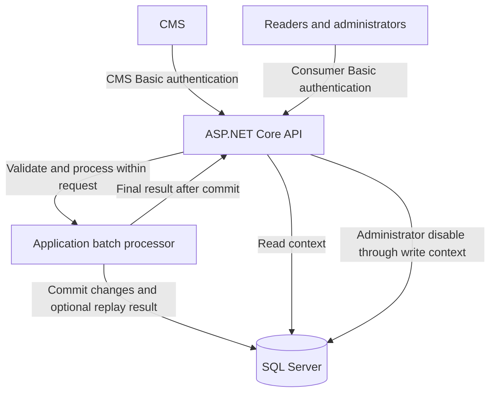

# CMS Event Processor

A .NET service for receiving CMS events, maintaining the latest entity state, and exposing confidential content through an authenticated API.

**Status: CMS ingestion, role-aware consumer reads, and administrator disabling are implemented.** Whole batches commit before success, with optional scoped replay. Consumer reads use bounded no-tracking SQL projections and cursor pagination; local overrides survive CMS publication. Provisioning, safe errors, OpenAPI, Postman, tests, CI, and container delivery are present. Administrator health checks, custom OpenTelemetry with optional export, pre-authentication rate limiting, and measured operational recovery are implemented.

## Start here

| Document | Purpose |
| --- | --- |
| [Native quickstart](#running-locally) | Run the API directly with the .NET SDK |
| [Docker quickstart](#running-with-docker) | Build and run the API container with SQL and HTTPS |
| [Assessment brief](docs/assessment/brief.md) | Readable assessment with the employer's requirements preserved |
| [Original assessment](docs/assessment/original.md) | Unmodified source supplied for the challenge |
| [Architecture](docs/architecture.md) | Components, persistence, security, and processing guarantees |
| [Domain lifecycle implementation](docs/entity-lifecycle.md) | Implemented state transitions, payload semantics, and unit-test evidence |
| [SQL persistence and processing](docs/persistence.md) | Database setup, explicit migrations, transaction/replay behavior, and real SQL tests |
| [API contract](docs/api.md) | Approved endpoint design, authentication, validation, and responses |
| [Webhook implementation](docs/webhook.md) | Implemented request validation, error mapping, HTTP/SQL tests, and OpenAPI access |
| [Consumer implementation](docs/consumers.md) | Visibility, pagination, local disabling, read/write separation, and SQL evidence |
| [Operations and troubleshooting](docs/operations.md) | Protected health, rate limits, sanitized telemetry, shutdown, and recovery |
| [Measured workload](docs/performance.md) | Reproducible synthetic workload and actual request/transaction/lock measurements |
| [Verification and evidence](docs/verification.md) | Suite commands, manual Postman walkthrough, CI, and assessment coverage |
| [Deployment and temporary demo](docs/deployment.md) | Local/tunnel setup, Azure alternatives, transport and cost assumptions |
| [Release procedure](docs/release.md) | Review, source tagging, image identity, and publication steps |
| [Postman walkthrough](docs/postman/README.md) | Executable CMS/reader/admin scenarios with empty shared credentials |
| [Authentication and credential setup](#authentication-and-credential-setup) | Account provisioning, configuration, and credential rotation |
| [Development and container setup](docs/development.md) | Configuration precedence, deployment secrets, and HTTPS container execution |
| [Architecture decisions](docs/decisions/001-synchronous-processing.md) | Rationale and tradeoffs for the processing approach; access and lifecycle decisions are linked from the architecture |

## Solution layout

The solution contains one production project and two test projects, all beside the solution file:

```text
cms-event-processor/
  CmsEventProcessor.slnx
  CmsEventProcessor/
    Api/
      Cms/
        Controllers/
        Dtos/
        Services/
        Validation/
      Documentation/
      Entities/
        Controllers/
        Dtos/
        Mappings/
        Validation/
      Authentication/
        Handlers/
        Options/
      Health/
      Operations/
      ErrorHandling/
      Provisioning/
    Application/
      Entities/
        Contracts/
        Exceptions/
        Models/
      Operations/
      Observability/
      Processing/
      Identity/
        Contracts/
        Models/
    Domain/
      Entities/
        Models/
        Services/
    Infrastructure/
      Persistence/
      Identity/
        Models/
        Options/
        Services/
    Program.cs
  CmsEventProcessor.UnitTests/
  CmsEventProcessor.IntegrationTests/
  docs/
  scripts/
```

The production folders separate responsibilities within a single assembly. Authentication and provisioning share the Application identity contracts and safe results. Infrastructure owns configured account hashes, verification, and file updates. The API adapts those contracts to Basic Authentication and account commands; `Program.cs` connects implementations through dependency injection. Domain owns the pure entity lifecycle rules, immutable snapshots, and content-free deletion markers.

Folder and namespace boundaries are maintained through review rather than separate project references. Tests check that shared identity contract signatures exclude HTTP/storage types and that authentication results contain no stored hashes. See the [identity boundaries](docs/architecture.md#shared-identity-boundaries) for the design rationale.

## Technology stack

- .NET 10 and ASP.NET Core.
- Entity Framework Core 10 and Microsoft SQL Server 2022 Developer for local development.
- Synchronous batch processing with one SQL transaction per request.
- Separate read/write contexts and CMS/consumer authentication policies.
- Unit tests, real SQL Server integration tests, and a Postman acceptance walkthrough.
- Custom OpenTelemetry metrics/traces with optional HTTP/protobuf export.
- Docker for local delivery; an optional temporary HTTPS tunnel for demonstrations.

The assessment permits .NET 9 or above. .NET 10 is our selected LTS target, rather than an alteration to the original requirement. See the [Microsoft support policy](https://dotnet.microsoft.com/en-us/platform/support/policy/dotnet-core).

## Architecture at a glance



The webhook returns `200 OK` with final outcomes only after the batch commits, or replays an existing committed keyed result. There is no background worker or status-polling endpoint. Database calls use `async`/`await`; synchronous processing means the response waits for completion, not that threads block on I/O.

The design prioritizes the difficult cases: unpublished revisions that were never published, delayed events, hard deletion, atomic batches, safe retries after a lost response, and administrator overrides that survive subsequent CMS publishes. Read the [architecture](docs/architecture.md) for the rules and their limitations.

## API availability

The [API contract](docs/api.md) contains behavior and examples. All listed routes are implemented, including protected health checks.

| Method | Route | Access | Purpose | Status |
| --- | --- | --- | --- | --- |
| POST | `/cms/events` | CMS | Commit a batch and return final outcomes | Implemented |
| GET | `/openapi/v1.json` | Any configured account | Download generated documentation with operation-specific security | Implemented |
| GET | `/api/entities` | Reader or administrator | List entities with role-based visibility | Implemented |
| GET | `/api/entities/{id}` | Reader or administrator | Read an entity with the same visibility rules | Implemented |
| PUT | `/api/entities/{id}/disable` | Administrator | Apply a persistent local disable | Implemented |
| GET | `/health/live` | Administrator | Check process availability | Implemented |
| GET | `/health/ready` | Administrator | Check database access and expected schema | Implemented |

## Authentication and credential setup

Accounts are provisioned explicitly through the implemented setup command. There is no registration, login/token endpoint, separate authentication service, or user database.

The setup utility creates three preconfigured accounts. Business and administrator health permissions are enforced by policies:

| Account | Permissions |
| --- | --- |
| CMS organization | Submit events and receive their processing results |
| Reader | Read published entities that are not administratively disabled |
| Administrator | Read all retained entities, disable them locally, and access health checks |

For each account, setup generates a unique username of 10-20 characters and a random GUID password. It hashes the password using ASP.NET Core Identity's PBKDF2 implementation and saves the username, hash, and account kind in ignored local configuration. The account kind determines the authentication scheme and role/policy. Generated plaintext passwords are displayed once by the setup command so they can be saved securely and entered into private Postman environments. They are not saved in application logs or committed files.

At startup, the API loads and validates the configured accounts. It does not create accounts or regenerate passwords. Re-running initialization refuses to overwrite an existing file; account addition and rotation are explicit commands.

Every protected request sends Basic credentials; ASP.NET Core authentication verifies the password against the configured hash, and authorization policies enforce the permissions above. Roles are configured server-side. An administrator account does not grant CMS ingestion access. External requests require HTTPS because Basic Authentication only Base64-encodes credentials. Development allows HTTP only from a loopback socket peer; forwarded headers cannot bypass that restriction.

In Postman, import the [collection and environment template](docs/postman/README.md), then fill the generated CMS, reader, and administrator credentials privately. Shared values remain empty. The walkthrough asserts final ingestion outcomes and queries consumer state immediately.

For deployment, load the same account definitions and password hashes from deployment secrets or environment-provided configuration. To add an account or rotate credentials, explicitly update the configuration and restart the application. A rotation generates and displays a new password, replaces its stored hash, and invalidates the previous password once the new configuration is loaded. There is no password-recovery endpoint; a lost password must be rotated.

See the [access decision](docs/decisions/003-access-and-read-write-boundaries.md) and [API access matrix](docs/api.md#access-matrix) for the authentication boundaries.

## Running locally

This quickstart takes a few operator steps once prerequisites are installed; SDK/image downloads and first SQL startup can take longer. Install the exact **.NET SDK 10.0.301** from [global.json](global.json) and Docker with x86-64 Linux containers, or use a compatible external SQL Server. On Apple Silicon, run the API natively against external SQL; see the [SQL guide](docs/persistence.md#local-sql-setup). Postman is optional for the walkthrough; Python is unnecessary for normal API execution.

1. Clone this repository and work from its root:

```sh
git clone https://github.com/Adamacenog/cms-event-processor.git
cd cms-event-processor
```

Copy `.env.example` to the ignored `.env` (`Copy-Item .env.example .env` in PowerShell, or `cp .env.example .env` in a POSIX shell). Edit `.env` privately to set a complex `SQL_SA_PASSWORD`. Change `SQL_PORT` if 1433 is occupied.
2. Start SQL and build the application:

```sh
docker compose up --detach --wait sql
dotnet restore CmsEventProcessor.slnx --locked-mode
dotnet tool restore
dotnet build CmsEventProcessor.slnx --configuration Release --no-restore
```

3. Generate the three accounts and save their displayed passwords securely:

```sh
dotnet run --project CmsEventProcessor --configuration Release --no-build --no-launch-profile -- accounts init --file appsettings.Local.json
```

`dotnet run --project` executes inside the project directory, so this creates `CmsEventProcessor/appsettings.Local.json`.

4. Edit that ignored JSON file, preserving its generated `Authentication` section. Add a sibling `Persistence` object with `WriteConnectionString` and `ReadConnectionString`, both initially targeting your same SQL primary. For Compose, use the following shape with the private password and selected port. Escape connection-string/JSON values correctly; [the configuration example](docs/examples/persistence.example.json) shows the JSON structure.

```text
Server=127.0.0.1,1433;Database=CmsEventProcessor;User Id=sa;Password=<private SQL password>;Encrypt=True;TrustServerCertificate=True;ConnectRetryCount=0
```

5. Apply migrations explicitly, then start the API:

```sh
dotnet tool run dotnet-ef -- database update --project CmsEventProcessor --context WriteContext --configuration Release --no-build
dotnet run --project CmsEventProcessor --configuration Release --no-build --launch-profile local
```

The local profile serves `http://127.0.0.1:5080`; HTTP is permitted only from a loopback socket peer. External access requires HTTPS. Startup validates accounts/connections without creating accounts or migrating storage. The local `sa` login and trusted development certificate are setup conveniences; [deployment guidance](docs/deployment.md) separates runtime/migration credentials and trusted TLS.

For interactive API exploration, open `http://127.0.0.1:5080/swagger`. The local profile opens this page automatically when launched by an IDE that honors browser launch settings; plain `dotnet run` starts the host without opening a browser. Sign in to the browser's Basic Authentication prompt with any provisioned account. In Swagger's **Authorize** dialog, set `cmsBasic` to the CMS credentials for ingestion and `consumerBasic` to reader or administrator credentials for consumer operations; disabling and health checks require an administrator. Swagger authorization is kept in page memory and is not persisted across refreshes. The browser may separately retain the initial Basic sign-in for its session. Use synthetic data: **Try it out** executes real requests against the running database. See [development documentation](docs/development.md#interactive-api-documentation) for access details.

Import the [Postman collection and local template](docs/postman/README.md), fill the three credential pairs privately, and run its 29 requests in order. The first request creates synthetic IDs; every successful ingestion result is final, and consumer checks run immediately. Alternatively, submit [the synthetic batch](docs/examples/cms-batch.json) with CMS Basic credentials. Anonymous consumer requests receive `401`. `/` has no application route; use the documented business, health, or OpenAPI routes.

Stop the API before editing account configuration. From the repository root, add or rotate explicitly and restart:

```sh
dotnet run --project CmsEventProcessor --configuration Release --no-build --no-launch-profile -- accounts add --file appsettings.Local.json --kind Reader
dotnet run --project CmsEventProcessor --configuration Release --no-build --no-launch-profile -- accounts rotate --file appsettings.Local.json --username <existing-username>
```

Replace `<existing-username>` before rotation. `--kind` accepts `Cms`, `Reader`, or `Admin`; only newly generated passwords are displayed. Initialization refuses an existing file. Local credential files are excluded from Git, publish output, and container context. Stop SQL with `docker compose stop sql`; its volume retains development data.

For container execution, follow [Running with Docker](#running-with-docker) below. For a temporary evaluator URL, follow [the optional demo guide](docs/deployment.md#temporary-cloudflare-demonstration).

## Running with Docker

This path runs **both SQL Server and the API in Linux containers**. Install Docker with an x86-64 Linux container engine and the pinned .NET SDK; the host SDK is used for one-time account provisioning, migrations, and development-certificate export. The API itself runs from the image. Run the commands from the repository root. For Apple Silicon or external SQL, use the [platform and external-database guidance](docs/persistence.md#local-sql-setup).

1. Copy `.env.example` to the ignored `.env` and set a private complex `SQL_SA_PASSWORD`; optionally change `SQL_PORT`. Start SQL, build the image, and prepare the setup tooling:

```sh
docker compose up --detach --wait sql
docker build --tag cms-event-processor:local .
dotnet restore CmsEventProcessor.slnx --locked-mode
dotnet tool restore
dotnet build CmsEventProcessor.slnx --configuration Release --no-restore
```

2. For a new setup, generate accounts and save the three displayed credential pairs securely. If `CmsEventProcessor/appsettings.Local.json` already contains your provisioned accounts, reuse it and skip initialization:

```sh
dotnet run --project CmsEventProcessor --configuration Release --no-build --no-launch-profile -- accounts init --file appsettings.Local.json
```

Add `Persistence:WriteConnectionString` and `Persistence:ReadConnectionString` to that file while preserving `Authentication`. For this **host-side migration**, both connections use `Server=127.0.0.1,<SQL_PORT>` and the private SQL password, as shown in [Running locally](#running-locally). Then apply the schema explicitly:

```sh
dotnet tool run dotnet-ef -- database update --project CmsEventProcessor --context WriteContext --configuration Release --no-build
```

3. Create the ignored `.secrets` directory if absent (`New-Item -ItemType Directory -Force .secrets` in PowerShell, or `mkdir -p .secrets` in a POSIX shell). Export a development HTTPS certificate, replacing the password placeholder with a private value:

```sh
dotnet dev-certs https --export-path .secrets/https.pfx --password <private-certificate-password>
```

Create the private `.secrets/container.env` with the following settings, replacing every password placeholder. Inside the Compose network, SQL uses **`sql,1433`**, regardless of the host's `SQL_PORT`. These container overrides take precedence over the host-side connections in the mounted account file:

```text
ASPNETCORE_ENVIRONMENT=Production
ASPNETCORE_URLS=https://+:8443
Persistence__WriteConnectionString=Server=sql,1433;Database=CmsEventProcessor;User Id=sa;Password=<private SQL password>;Encrypt=True;TrustServerCertificate=True;ConnectRetryCount=0
Persistence__ReadConnectionString=Server=sql,1433;Database=CmsEventProcessor;User Id=sa;Password=<private SQL password>;Encrypt=True;TrustServerCertificate=True;ConnectRetryCount=0
Kestrel__Certificates__Default__Path=/run/secrets/https.pfx
Kestrel__Certificates__Default__Password=<private-certificate-password>
```

Use the same database name you migrated if you customized it. Keep this environment file, the account configuration, and certificate private; they are excluded from Git and the image build context.

4. Replace both mount placeholders below with absolute host file paths, preserving the quotes. Run the API on the Compose SQL network, with account configuration and certificate mounted read-only:

```sh
docker run --rm --name cms-event-processor-api --network cms-event-processor_default --publish 127.0.0.1:8443:8443 --env-file .secrets/container.env --mount "type=bind,source=<absolute-account-file>,target=/app/appsettings.Local.json,readonly" --mount "type=bind,source=<absolute-certificate-file>,target=/run/secrets/https.pfx,readonly" cms-event-processor:local
```

The account file is `CmsEventProcessor/appsettings.Local.json`; the certificate is `.secrets/https.pfx`. The image runs as a non-root user. On Linux, owner-only files may require adding `--user "$(id -u):$(id -g)" --env HOME=/tmp` so that user can read the mounts; preserve restrictive file permissions. If you override the Compose project name, adjust the network name accordingly. See [container configuration details](docs/development.md#container-build-and-https-execution) for file-sharing and external-SQL variants.

5. Access **`https://localhost:8443`**, trust the development certificate through your OS/client workflow, and set the private Postman environment's `baseUrl` to that address. Run the same 29-request walkthrough with the generated CMS/reader/admin credentials. Health checks require the administrator account. A shared deployment needs a trusted hostname-matching certificate and appropriately scoped SQL credentials.

The API runs in the foreground; stop it with Ctrl+C, or run `docker stop --time 15 cms-event-processor-api` from another terminal. `--rm` removes the stopped API container. Stop SQL separately with `docker compose stop sql`; its named volume retains data. Account changes require restarting the API, and migrations remain explicit operator commands.

## Tests and code conventions

From the repository root after the Release build:

```sh
dotnet format CmsEventProcessor.slnx --verify-no-changes --no-restore
dotnet test CmsEventProcessor.slnx --configuration Release --no-build --no-restore --filter "Category!=Sql"
dotnet test CmsEventProcessor.IntegrationTests --configuration Release --no-build --no-restore --filter "Category=Sql"
```

The first test command needs no SQL. SQL cases need Docker or a private `CMS_TEST_SQL_CONNECTION` to a dedicated test server. Omit the filter to run all .NET suites when SQL is available. See [verification](docs/verification.md) for the suite matrix and evidence boundaries, and use [Postman](docs/postman/README.md) for the manual API walkthrough. Python is used only by the separate optional [load exercise](docs/operations.md#reproduce-the-synthetic-load-exercise).

Domain unit tests cover ordering/publication/deletion decisions, semantic JSON content comparison, immutable state, and local overrides. Identity unit tests cover account generation, hashing, safe file updates, configuration validation, startup snapshots, and contract/result boundaries. HTTP integration tests run the actual middleware with isolated credentials and test-only routes, covering scheme/role boundaries, malformed headers, transport security, response/log privacy, missing configuration, and credential rotation after restart. Real SQL tests verify atomic processing, replay, retention, concurrency, cancellation, failure boundaries, and migrations; see the [SQL test guide](docs/persistence.md#test-execution-and-evidence).

Each type has its own file. Types and methods have multiline XML summaries; test summaries state the scenario and expected behavior. Method inputs, returned values, and meaningful propagated exceptions use XML documentation tags. Fields/properties receive notes only for particular constraints or behaviors. XML documentation is generated during builds, and missing public documentation fails the build. CI runs locked restore, formatting, Release build, and unit/HTTP tests on Windows and Linux. The Linux job additionally runs real SQL container tests before the application container build. Exact revision results are linked in the PR and Actions. Test-only probe controllers are excluded from the shipped application.

The webhook, consumer endpoints, and Postman business walkthrough are available. SQL Server containers require an x86-64 Linux environment; Apple Silicon reviewers can configure a remote compatible SQL Server as described in the SQL guide. See [Microsoft's platform guidance](https://learn.microsoft.com/en-us/sql/linux/install-upgrade/setup).

## Delivery

The [verification guide](docs/verification.md) maps assessment requirements to executable evidence. Native/container setup and the optional temporary demo are documented; Azure options are proposals with transport and cost prerequisites. Source tags and image publication follow the [reviewed release procedure](docs/release.md). No paid hosting is required or provisioned by this repository.
