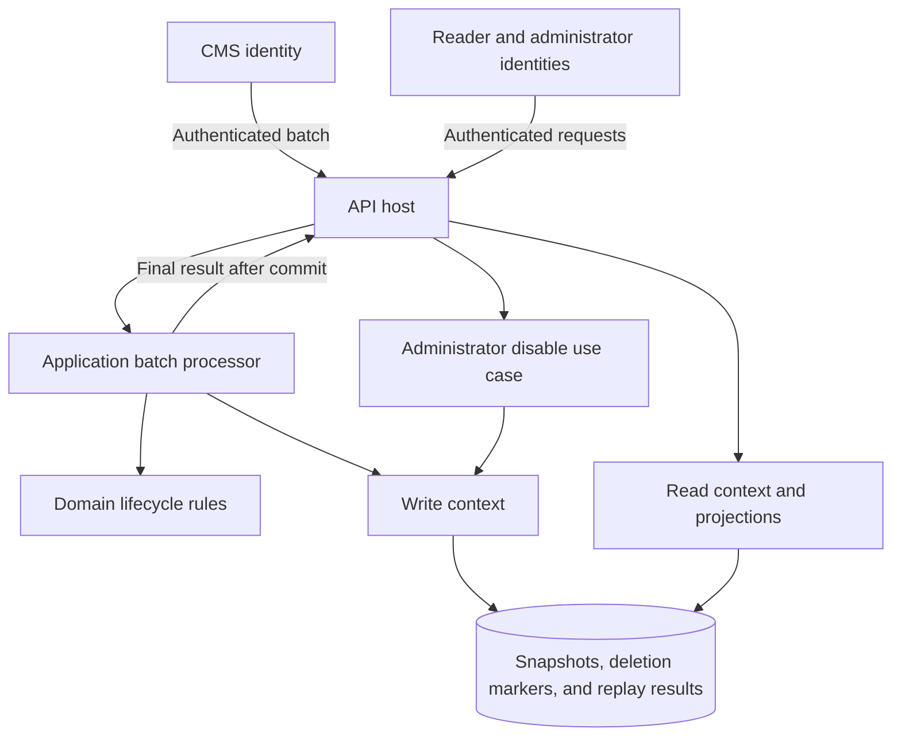
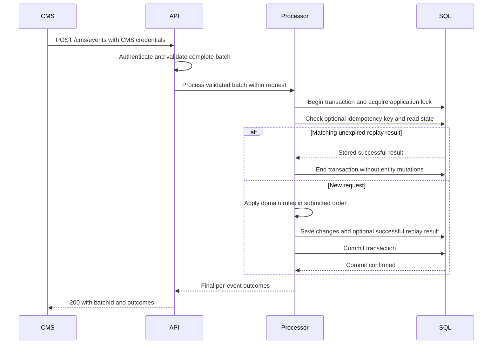

# Architecture and processing contract

**Status: approved design; application implementation has not started.**

## Goals and scope

Maintain the latest CMS entity snapshot correctly under duplicate and delayed delivery; keep all content restricted; and make the service straightforward to run and review.

The baseline is .NET 10, ASP.NET Core controllers, EF Core 10, and SQL Server 2022 Developer for local development. Pin supported SDK, package, and container versions when the corresponding artifacts are implemented. Deploy one API application that processes each bounded batch within its HTTP request.

Synchronous processing describes the request lifecycle: the response waits for a committed result. Continue using `async`/`await` for database I/O, without blocking threads. There is no hosted worker, queue, durable inbox, or background retry loop.

The assessment leaves architecture open. Our choices and assumptions are documented here rather than added to the [employer's requirements](assessment/brief.md).

## Components and dependencies

| Project | Owns | References |
| --- | --- | --- |
| `CmsEventProcessor.Domain` | Entity lifecycle, event decisions, publication state, local override | No other solution project |
| `CmsEventProcessor.Application` | Batch processing, queries, disabling, and purpose-specific persistence contracts | Domain |
| `CmsEventProcessor.Infrastructure` | EF mappings/migrations, transactions, idempotency records, queries, database coordination | Application and Domain |
| `CmsEventProcessor.Api` | Controllers, transport DTOs, authentication, authorization, request deadlines, composition | Application and Infrastructure |

Add unit and integration test projects. Group application code by feature. Keep domain rules independent of HTTP and EF. Use explicit DTOs and dependency injection; do not introduce a generic repository framework, mediator library, broker, or separate microservice for this assessment.



## Synchronous transactional processing

1. Authenticate the CMS identity and validate the entire request before processing any events.
2. Begin a SQL transaction and acquire the mutation lock. If an unexpired idempotency key exists, check its body hash before evaluating domain rules: replay the stored success for a match, or reject conflicting reuse.
3. Evaluate events in submitted order and apply the entire batch within that transaction.
4. If a key was supplied, save its body hash and successful response metadata in the same transaction as the entity changes. Never store the submitted body.
5. Commit before returning `200` with the batch correlation ID and final per-event outcomes. If processing fails before commit, roll back the entire transaction and return an appropriate error when the connection permits.



### Atomicity, coordination, and request lifetime

- Batch validation is all-or-nothing. Duplicates and stale events are successful skips; a domain conflict returns `409` after rolling back all mutations from the batch.
- Use one database-scoped exclusive application-lock resource for ingestion and administrator mutations. Acquire it inside the write transaction, before reading mutable state or idempotency records. Check acquisition results and never continue without the lock. A unique constraint on CMS identity plus key also protects idempotency records.
- This intentionally serializes state mutations across application instances. Bound batch size and lock waits; measure contention before considering per-entity coordination or parallel processing.
- Use a configurable processing deadline, default 30 seconds, covering connection establishment, lock acquisition, database operations, and commit. Link it to request cancellation and pass cancellation through database calls; do not reset the overall budget for individual operations.
- A crash or cancellation before commit leaves no committed batch changes or new idempotency record. Dispose/roll back the transaction and release locks. A cancellation or disconnect around/after commit does not prove rollback; a committed transaction cannot be undone by request cancellation.
- Return `503` for transient database failures, lock unavailability, and processing deadlines when a response can still be delivered. Do not automatically replay transactions within the request or in a background task; the caller owns retries.
- There is no pending-work recovery after restart. The CMS must resubmit an interrupted request. Successful keyed results survive restart because their metadata is committed with the entity changes.
- After `200`, reads against the primary database observe committed state, subject to any later concurrent mutations. Read replicas and their consistency lag are outside this baseline.

### Idempotency and response loss

Keep the optional CMS-scoped idempotency key for seven days after successful completion. Compare the SHA-256 hash of the exact request bytes. A matching key/body returns the stored successful response without reapplying events, including its original batch ID and outcomes. Conflicting key reuse returns `409`. Failed transactions neither reserve a new key nor cache a failure result.

The client may lose the response even though commit succeeded. Retry with the same key and identical body to recover the result. Without a key, domain rules still protect duplicate entity effects, but a replay may return new skip outcomes and a new correlation ID. The service does not promise automatic eventual delivery or end-to-end exactly-once execution.

Expired keys are ignored/replaced transactionally. Bounded opportunistic cleanup during processing requests removes expired records without a hosted cleanup service. See [ADR 001](decisions/001-synchronous-processing.md).

## Entity lifecycle

Maintain separate values for `CmsPublished` and `AdminDisabled`:

```text
VisibleToReader = CmsPublished && !AdminDisabled
```

Administrators can read all retained entity snapshots, including disabled/unpublished ones. Deleted entities are absent even for administrators; a deletion marker is not a consumer entity.

| Event or action | Result |
| --- | --- |
| First `publish`, at any positive version | Create a published snapshot. Accept a first-observed version greater than 1 because delivery may begin after earlier revisions. |
| Newer `publish` | Update payload/version and CMS publication state; preserve the local admin override. |
| `unPublish` with an unseen newer version | Store the supplied payload/version and mark unpublished, even if that revision was never published. |
| `unPublish` for an unknown ID | Create an unpublished snapshot from its supplied data. |
| Admin disable | Set the local override without changing CMS version, payload, timestamp, or publication state. Repeated disable is a no-op. |
| Applicable `delete` | Hard-delete the snapshot and override; retain only a deletion marker with its source timestamp. |
| `delete` for an unknown ID | Create or advance the marker so older deliveries cannot create the entity later. |
| Event at or before a deletion marker | Skip; it cannot recreate the deleted entity. |
| Publish/unpublish strictly after a deletion marker | Recreate a new lifecycle from the supplied snapshot and remove the marker. The old override does not carry across hard deletion. |

### Ordering and conflict rules

IDs are opaque and case-sensitive. Timestamps represent source event time, include an explicit UTC offset, and are normalized to UTC. Versions start at 1 and increase within an entity lifecycle; gaps are valid.

Evaluate events in this order:

1. If a deletion marker exists, apply the marker rules above. Equal-time deletion always wins.
2. For a live entity, an event older than its last accepted CMS timestamp is stale. Ignore it, including when it claims a higher version; the protocol assumes monotonic source time for newer revisions.
3. A delete at or after that timestamp hard-deletes the snapshot. Its version is not needed.
4. For publish/unpublish, a lower version is stale. A higher version at an equal or later timestamp replaces the content and applies the requested CMS publication state.
5. For the same current version, compare parsed JSON values, ignoring object-property order while preserving array order and values. Different content is a conflict. Formatting differences alone are not different content.
6. With equal content/version, a later timestamp may change publication state. At an equal timestamp, unpublish wins over publish; an identical state is a duplicate. Never lower a version or change an override due to a CMS publish/unpublish.

Skipped events do not advance entity watermarks. A newer same-version event that leaves publication unchanged still advances the CMS timestamp, so an intervening stale lifecycle event cannot override it later.

The schema supplies neither event IDs nor a version on deletes. Reliable ordering of conflicting historical events with unreliable clocks cannot be recovered from this input. Treat comparable, monotonic CMS timestamps as an explicit assumption, not a proven upstream guarantee. Conflicting contents for an already discarded older revision cannot be detected without history; those events are simply stale. See [ADR 002](decisions/002-entity-lifecycle.md).

## Persistence and read/write separation

| Record | Minimum responsibility |
| --- | --- |
| Entity snapshot | Unique source ID, JSON payload, latest version, accepted CMS timestamp/type, CMS publication flag, admin override, and concurrency token |
| Deletion marker | Unique source ID and latest delete timestamp; no payload or consumer-visible entity data |
| Successful idempotency result | CMS principal ID plus unique key, request-body hash, batch correlation ID, final response metadata, completion/expiry timestamps; no submitted body or entity payload |

Use EF mappings and explicit migrations. Store payloads as validated JSON in `nvarchar(max)`, with a database JSON check. Specify a case-sensitive binary collation for source IDs and use database ordering consistently for cursors and comparisons. Keep source version and SQL concurrency tokens distinct.

The write context owns changes and transactions. A separate read context defaults to no tracking, projects directly into response DTOs, and rejects save operations. Configure read/write connection strings separately; both initially target the same database. This is application-level separation, not a promise of physical replicas or database-enforced read-only credentials. An optional read-only SQL login can strengthen the boundary later.

Index source IDs, the reader-visible listing path, the idempotency constraint, and expired-result cleanup. Keep queries bounded and avoid loading full collections or tracking records for consumer reads. Use cursor pagination ordered by source ID; it is not a snapshot across concurrent updates. See [ADR 003](decisions/003-access-and-read-write-boundaries.md).

### Retention

- Current entity payload: retained while the entity exists, including when unpublished or locally disabled.
- Submitted batch bodies: never persisted separately, on success or failure. Applicable entity content is stored only in its current snapshot.
- Successful idempotency results: valid for seven days after completion. Expired records are ignored even if physical cleanup has not yet run. Delete at most 100 expired records opportunistically per processing request; an idle service may retain expired metadata until later traffic arrives.
- Unkeyed response metadata: returned to the caller without a durable batch-history record. Safe correlation and outcomes are logged; submitted bodies and payloads are not.
- Deletion markers: retained indefinitely for this assessment, unless superseded by a genuinely later lifecycle. Expiry would weaken stale-replay protection.

Hard deletion applies to the entity snapshot. Successful replay results contain metadata only; no request body or copied entity content survives there. Database backups have a separate lifetime, so this is not a comprehensive data-erasure guarantee. Logs must never contain payloads in the first place.

## Security and observability

Use separate CMS and consumer Basic authentication schemes with server-side policy/role mapping. Generate GUID passwords; configure only hashes in untracked configuration or a secret provider. Usernames are unique and 10–20 characters long. No registration, user management, or re-enable endpoint is in scope.

Provision the three initial accounts explicitly during setup, display their generated passwords once, and load their configured identities/hashes at application startup without creating or regenerating accounts. Adding accounts or rotating credentials updates configuration and takes effect after a restart. The full local/deployment lifecycle is documented in [authentication and credential setup](../README.md#authentication-and-credential-setup).

All documented endpoints require authentication. Only CMS credentials can submit events and receive their processing results. Idempotency lookup is scoped to that CMS identity; it is not exposed as a separate endpoint. Protect interactive API documentation when exposed. External traffic uses HTTPS; local HTTP is allowed only on loopback for development or the tunnel connector. Never expose SQL through the public tunnel, and do not trust forwarded headers from arbitrary clients.

Validate structure and limits, reject ambiguous JSON, preserve valid CMS data, and use parameterized EF access. Do not strip HTML from arbitrary content or claim that storing JSON makes it safe to render as HTML elsewhere. Disable caching of confidential API responses.

Emit structured event/batch outcomes and safe error codes from the first processing implementation. Log applied outcomes only after confirmed commit; distinguish rolled-back or uncertain results from success. Do not log request bodies, payloads, passwords, authorization headers, or EF parameter values. Use batch IDs and keyed hashes of entity identifiers when correlation is necessary; avoid high-cardinality identifiers in metric labels. The operational design includes OpenTelemetry, request/transaction duration, throughput, lock contention, failure metrics, and protected readiness/liveness. Readiness depends on database access and expected schema, not a worker loop.

## Local delivery and future deployment

Provide native .NET and Docker Compose execution with an explicit migration step. Keep migration privileges separate from routine runtime privileges when deploying beyond local development. SQL Server 2022 Developer is for development/test use, not a production licensing choice.

SQL Server containers require an x86-64 Linux environment. Apple Silicon reviewers can run the application natively against remote SQL Server/Azure SQL; do not present unsupported container emulation as a guaranteed setup. See [SQL Server platform guidance](https://learn.microsoft.com/en-us/sql/linux/install-upgrade/setup).

The agreed live demo is local Docker plus an optional temporary Cloudflare Quick Tunnel, within a US$5 ceiling and without provisioning paid hosting. It needs a running computer and has a temporary URL with no uptime guarantee. Use synthetic content and share credentials separately. See [Quick Tunnel documentation](https://developers.cloudflare.com/tunnel/get-started/quick-tunnels/).

Document Azure Container Apps plus Azure SQL Database as a future managed option. The design has no continuous queue polling or worker-driven minimum-replica requirement. Evaluate cold-start latency and database availability when selecting hosting settings; do not promise free hosting or a guaranteed cost ceiling. Service Bus, Redis, physical read replicas, and background processing remain future alternatives that require a separate agreed design change.
