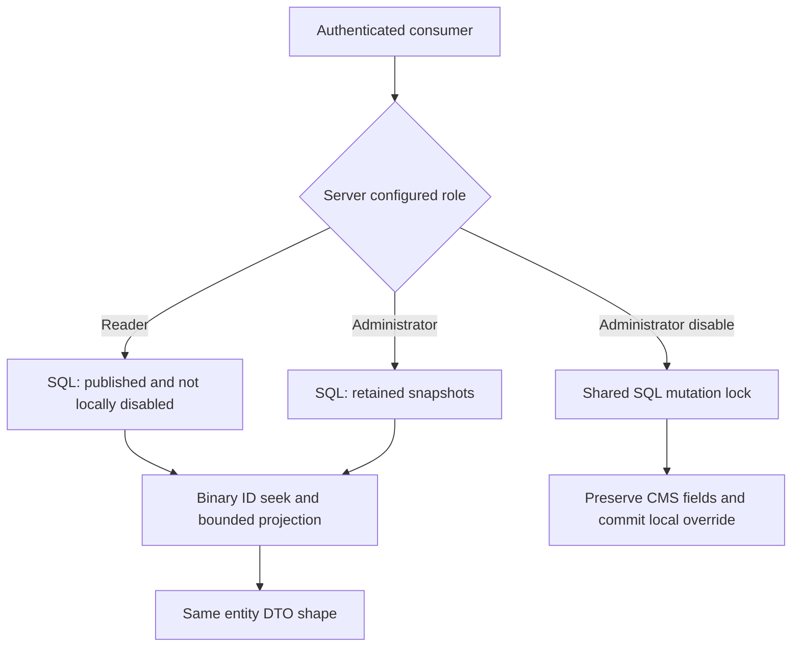

# Consumer reads and local disabling

`GET /api/entities`, `GET /api/entities/{id}`, and `PUT /api/entities/{id}/disable` are implemented. The [API reference](api.md#get-apientities) describes their parameters, response shapes, status codes, and retry semantics. Consumer identities differ from the CMS organization; all business responses use no-store.

## Visibility

| CMS published | Admin disabled | Reader | Administrator |
| --- | --- | --- | --- |
| Yes | No | Visible | Visible |
| Yes | Yes | Hidden | Visible |
| No | No | Hidden | Visible |
| No | Yes | Hidden | Visible |
| Hard deleted / absent | Not retained | Absent | Absent |

Both roles use the same list/lookup routes and response shape. Hidden lookups return the same 404 shape as missing/deleted entities. Readers cannot disable; neither consumer role can replace content or CMS versions. Administrator disabling changes only the local flag, survives later CMS publication, and ends when hard deletion removes that lifecycle. Strictly later recreation starts without the previous override.

## Responsibilities

| Area | Responsibility |
| --- | --- |
| Api/Entities/Controllers | Consumer/admin policies, validated inputs, HTTP results, and abort propagation |
| Api/Entities/Dtos | Snapshot and bounded-page wire shapes |
| Api/Entities/Mappings | Small explicit snapshot mapper reused by list and lookup |
| Api/Entities/Validation | Safe paging errors, exact route IDs, and visibility-bound cursors |
| Application/Entities | Purpose-specific read contract, owned models, and safe read failure |
| Infrastructure/Persistence/Services | Fresh read context and SQL visibility/seek/projection/limit under one budget |
| Application/Processing | Existing transactional disabling coordinated with ingestion |

The API depends on the read contract and mutation service; it does not query EF or accept a client-selected role. SQL selects only required snapshot columns. JSON is parsed after SQL bounds the result, then cloned to survive context/document disposal. No generic repository, mapping package, new production project, or schema migration is required.

## Pagination and consistency

Page size defaults to 20 and is bounded to 1-100. Visibility is applied before strict continuation and binary source-ID ordering. Each request fetches at most pageSize plus one projected row; the extra row determines whether a next cursor exists. No total count or offset query is needed. Empty results have items: [] and nextCursor: null.

Canonical versioned base64url cursors contain the last returned ID and visibility, with a 520-character input bound. They are opaque continuations, not signed authorization tokens, encrypted values, or database snapshots. Deleting the cursor's source row does not invalidate continuation. Switching reader/admin visibility requires starting a new sequence. An unchanged dataset has stable complete traversal; concurrent mutations can change later pages.

Read/write connections are independently configurable and should target the same primary for the immediate-read walkthrough. A lagging replica would weaken that behavior and is not claimed. Reads use no tracking, fresh contexts, the cooperative Processing:Timeout budget (default 30 seconds), request cancellation, and no automatic retries. Read-context save guards are an application boundary; database-enforced privileges remain an operator concern.

## IDs, privacy, and documentation

Encode each ID as one URL segment. The API decodes the original raw segment once, preserving case, Unicode, encoded slashes, and literal percent spellings. ASP.NET [route parameters are not always URL decoded](https://learn.microsoft.com/en-us/aspnet/core/fundamentals/routing?view=aspnetcore-10.0#routing-with-special-characters); decoding an already-bound value again can conflate IDs. TestServer cases explicitly provide its omitted RawTarget feature, while native Kestrel verification exercises actual encoded URLs.

Framework request/routing/action diagnostics can print confidential IDs and cursors. Targeted production filters suppress those categories while safe application logs remain enabled. EF provider logging stays suppressed because exception text may contain values. Tests first reproduced raw-path leakage, then checked the configured boundary. Proxy/access logs must follow the same confidentiality policy; these application checks do not prove external infrastructure behavior.

Any configured account may retrieve generated `/openapi/v1.json`; each operation still declares/enforces its separate CMS or consumer scheme. The [27-request Postman walkthrough](postman/README.md) covers CMS, reader, and administrator flows with immediate reads, empty shared credentials, no polling, and no processing sleeps.

## Verification boundaries

Unit tests cover identifier/cursor fidelity, invalid Unicode, canonical/version/visibility bounds, strict page input, and original-segment decoding. Production HTTP tests cover anonymous/cross-scheme/wrong-role requests, bad input, known/unknown-length disable bodies, absent content-update actions, log privacy, and authenticated documentation.

Real SQL cases cover every visibility combination, list/lookup consistency, preserved large numbers, binary pagination, executed TOP/projection SQL, deleted-row/terminal cursors, empty/missing state, hard deletion/recreation, idempotent disabling/rowversion, ingestion/admin races in both orders, commit-before-204, uncertain commit/retry, separate read-connection failure, deadline, and cancellation. Injected probes do not prove every network/OS crash. Hosted CI, published-host/container execution, and Postman evidence are reported separately in the PR.
