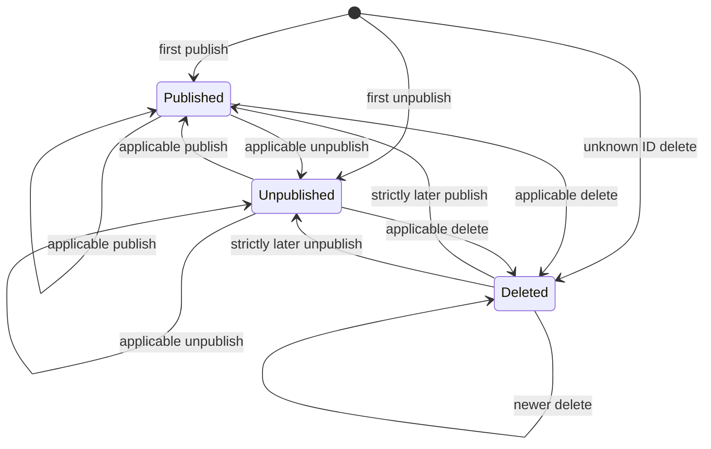

# Domain lifecycle implementation

The domain now evaluates one CMS event against an optional current snapshot or deletion marker. It returns proposed state and an applied, skipped, or conflict decision. It does not access storage, log content, read a clock, start background work, or claim that a batch transaction committed.

The [architecture's ordered decision table](architecture.md#entity-lifecycle) and [ADR 002](decisions/002-entity-lifecycle.md) remain the accepted policy. Comparable source timestamps, tie precedence, and recreation after deletion are documented design assumptions rather than additional employer requirements.

## Source responsibilities

All types live in the production project's [Domain/Entities](../CmsEventProcessor/Domain/Entities) folder:

| Piece | Responsibility |
| --- | --- |
| Models/CmsEvent and CmsEventType | Validated action, exact identifier, UTC timestamp, and action-specific version/content |
| Models/EntityPayload | Owned, unmodified JSON object with semantic value comparison |
| Models/EntitySnapshot | Current content/version/time, CMS publication, local disable, and reader visibility |
| Models/DeletionMarker | Identifier and UTC deletion time only; no retained content or override |
| Models/EntityTransition, TransitionOutcome, and TransitionReason | Proposed replacement state plus safe decision classification |
| EntityRules | Shared identifier and positive-version invariants |
| Services/EntityLifecycle | Pure ordering and publication/deletion decisions |

Types remain internal to the production assembly. There are no domain interfaces or additional packages. A retained snapshot and deletion marker cannot coexist in a valid evaluation; state must match the event's ordinal identifier.

Models owning confidential content are classes without generated record formatting that would include their properties in a default string representation. Their properties must still never be destructured into logs.

## Evaluation and state ownership

Call EntityLifecycle.Apply with a validated event and either its current snapshot, its marker, or neither. Applied results carry replacement state. Skipped/conflict results preserve the previous state object. Inputs are immutable, so evaluating a later event does not change a previously observed snapshot.

A caller must use the returned state explicitly. The application processor persists it inside the request's transaction. An applied domain result alone is not durable success, and a conflict result does not independently roll back earlier events in a batch.

Snapshot.Disable returns a snapshot with only AdminDisabled changed, or the same object if already disabled. It cannot change source content, version, time, or publication. Reader visibility is CmsPublished && !AdminDisabled; administrator endpoint authorization and listing are implemented in the [consumer API](consumers.md).



This diagram summarizes publication states; every transition is subject to the architecture's timestamp/version rules. Local disabling is a separate flag, preserved across publish/unpublish and removed by hard deletion.

## Example sequence

All times are source times for the same exact identifier:

| Action | Source time | Proposed state or decision |
| --- | --- | --- |
| Publish revision 1 | T0 | Published revision 1 |
| Local administrator disable | No CMS time change | Revision 1 retained, hidden from readers |
| Unpublish unseen revision 3 | T10 | Revision 3 content retained, unpublished, local override preserved |
| Republish revision 3 with equal content | T20 | Published, still locally disabled; watermark advances to T20 |
| Delayed publish revision 99 | T15 | Stale despite the higher revision; no watermark change |
| Delete without a revision | T30 | Snapshot/override absent; only deletion metadata remains |
| Publish at the marker time | T30 | Stale; equal-time delete wins |
| Publish revision 1 | T31 | Fresh lifecycle, published, no inherited override |

For the same current version, different content at an equal/later timestamp conflicts before publication tie-breaking. Older timestamps and superseded versions are stale before content comparison. Equal-time/version/content unpublish wins over publish. A later same-version action advances the watermark even if publication is unchanged.

An equal-time repeat delete is a duplicate; an older delete is stale, and a newer delete advances the marker. Publish/unpublish at or before a marker is stale.

## Payload semantics and input boundaries

EntityPayload clones the parsed object so it remains valid after the caller disposes its JsonDocument. Source content is preserved, including HTML-like strings, exact numeric spelling, and object-property order. No HTML sanitization or numeric rewriting occurs.

Comparison uses the framework's [JsonElement.DeepEquals](https://learn.microsoft.com/en-us/dotnet/api/system.text.json.jsonelement.deepequals?view=net-10.0): object-property order and insignificant number formatting do not cause conflicts, while array order, ordinal strings/property names, types, and exact numeric values remain significant. Numbers are not rounded through double or decimal conversions.

Duplicate property names are rejected recursively, including escaped-equivalent names and objects inside arrays. Differently cased property names remain distinct. Identifiers retain their exact case/value within the documented length/character constraints. Publish/unpublish require a positive 64-bit version and object payload; optional delete versions are validated but do not order deletion.

The HTTP adapter will still need to enforce body/batch/depth limits, explicit-offset timestamp text, wire action names, and envelope validation. DateTimeOffset domain values normalize already-parsed instants to UTC; they cannot prove whether the original timestamp text included an offset. These remaining checks do not become implemented merely because domain constructors validate their own invariants.

## Verification

The [lifecycle tests](../CmsEventProcessor.UnitTests/Entities/EntityLifecycleTests.cs) exercise missing revisions, unknown unpublish/delete, stale deliveries, duplicates, conflicts, timestamp/version precedence, publication ties, watermark advancement, and recreation after deletion.

The [visibility tests](../CmsEventProcessor.UnitTests/Entities/EntityVisibilityTests.cs) check every flag combination and idempotent local disabling. The [payload tests](../CmsEventProcessor.UnitTests/Entities/EntityPayloadTests.cs) cover ownership, nested comparison, precise numbers, preserved values, and ambiguous object rejection. The [input tests](../CmsEventProcessor.UnitTests/Entities/EntityInputTests.cs) cover event/state invariants and ordinal identifier ownership.

Run the domain cases from the repository root:

```sh
dotnet test CmsEventProcessor.UnitTests/CmsEventProcessor.UnitTests.csproj --configuration Release --no-build --no-restore --filter "FullyQualifiedName~Entities"
```

Use the README's restore/build commands before running with --no-build. Current evidence covers pure domain behavior and the existing authentication pipeline. SQL transaction/deletion guarantees, complete batches, migrations, and business endpoints remain subsequent work.
