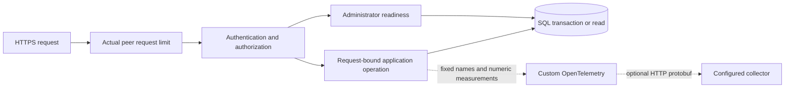

# Operations and measured workload

The service exposes protected health probes, a pre-authentication request limit, and custom OpenTelemetry metrics/traces. Processing remains synchronous within each request. Telemetry export never retries business transactions or stores submitted bodies.

## Health and graceful shutdown

| Administrator endpoint | Healthy response | Dependency failure |
| --- | --- | --- |
| `GET /health/live` | `200 {"status":"live"}` | Independent of SQL while HTTP is serving |
| `GET /health/ready` | `200 {"status":"ready"}` | `503 {"status":"unavailable"}` |

Both return `application/json` and `Cache-Control: no-store`. Missing/invalid consumer credentials or CMS credentials receive `401`; an authenticated reader receives `403`. Configure monitoring with a privately provisioned administrator credential over HTTPS. No anonymous probe exception is present.

Each readiness request checks the writer's applied migration history against this build, then executes actual zero-row queries against required snapshot, deletion, and replay columns. It separately checks snapshot columns through the configured reader connection. The runtime writer therefore needs `SELECT` on `__EFMigrationsHistory` as well as the permissions described in the [SQL guide](persistence.md). It does not migrate or repair storage, enumerate content, run a write probe, audit indexes/constraints/permissions comprehensively, or establish replica freshness. A failed business validation/conflict does not change readiness.

Readiness uses one cooperative three-second budget. Connection/provider cleanup may extend wall time; this is not a hard process-kill deadline. Application stopping is checked both before and after the probe so shutdown cannot return a successful readiness result. Liveness may remain available while the process drains existing requests.

The host's graceful-shutdown budget defaults to ten seconds. SIGTERM stops new admission and allows in-flight requests to finish within the host's drain budget. Request cancellation flows through existing SQL work; before commit, disposal rolls back the transaction and releases its lock. A disconnect around commit can still mean successful storage: retry with the same CMS identity, exact bytes, and idempotency key. Configure the platform's termination grace period longer than the host budget and allow for provider cleanup. The thirty-second processing budget can exceed the ten-second shutdown budget; an interrupted caller must retry. This does not promise every accepted request completes during termination.



## Request limit

The global fixed-window limit defaults to **600 requests per minute per actual socket peer, per process**, with no queue. It runs before password verification, including invalid credentials, valid business calls, health checks, documentation, and unknown routes. Excess calls receive safe `429 application/problem+json`, `errorCode: rate_limit_exceeded`, `Retry-After` in seconds, and `no-store`. Transport rejection occurs earlier in the pipeline.

IPv4 and mapped IPv6 addresses share a partition. `X-Forwarded-For` cannot select a different partition. This bounds repeated credential hashing from one peer; it is not a distributed abuse-prevention service. Clients behind the same NAT, proxy, or tunnel share its socket peer budget. Multiple API instances have independent limits. Configure a trusted edge's limits separately when deploying behind a proxy; do not enable arbitrary forwarded-header trust. Adjust the limit explicitly for a dedicated benchmark rather than interpreting throttled throughput as database capacity.

## Configuration

Defaults are committed in `appsettings.json`. Override them through private local/deployment configuration or environment variables, using `__` in place of `:`:

| Setting | Default | Valid range or meaning |
| --- | --- | --- |
| `Operations:ReadinessTimeout` | `00:00:03` | Positive, at most 30 seconds |
| `Operations:ShutdownTimeout` | `00:00:10` | Positive, at most two minutes |
| `AuthenticationRateLimit:PermitLimit` | `600` | 1–100,000 |
| `AuthenticationRateLimit:Window` | `00:01:00` | Positive, at most one hour |
| `Observability:ExportEnabled` | `false` | Explicitly enables both metrics and traces |
| `Observability:Endpoint` | `http://127.0.0.1:4318/` | Absolute collector base URI: HTTPS or loopback HTTP; no user information, query, or fragment |

Invalid values fail startup with fixed validation messages. Account provisioning remains independent of operational options and SQL. Processing/read budgets remain under `Processing`, described in the [SQL guide](persistence.md).

With export enabled, the SDK sends HTTP/protobuf to `<Endpoint>/v1/traces` and `<Endpoint>/v1/metrics`. Metrics export every ten seconds; traces use the SDK batch processor. Each export is bounded to three seconds. The collector is optional: business requests do not wait for a collector acknowledgment. Missing export data is not evidence that a business transaction failed. Buffered telemetry may be lost on forceful termination. No collector, dashboard, cloud service, or paid infrastructure is provisioned by this repository.

## Instruments and privacy

Source/meter: `CmsEventProcessor.Operations`, version `1.0.0`; resource: service name `cms-event-processor` and its SDK attributes. Only this source/meter is subscribed. There is no automatic ASP.NET, SQL, HTTP-client, exception, or log export. Export starts fresh local request traces, discarding incoming trace parent, trace state, and baggage; nested custom operations share that safe trace. This sacrifices upstream trace continuity to keep untrusted request context out of exported telemetry.

| Instrument | Unit | Fixed dimensions / interpretation |
| --- | --- | --- |
| `cms.http.requests` | requests | Whitelisted route template, `GET`/`POST`/`PUT`/`OTHER`, HTTP status |
| `cms.http.duration` | seconds | Same dimensions; full wrapped pipeline including safe error handling |
| `cms.operations.completed` | operations | `batch`, `disable`, `read`, `transaction`; bounded internal outcome |
| `cms.operations.failures` | operations | Same; excludes success, replay, expected not-found, and rollback-only transaction completion |
| `cms.operations.duration` | seconds | Same; full application scope |
| `cms.events.committed` | events | Applied/skipped decisions in newly acknowledged successful batches |
| `cms.transactions.duration` | seconds | `committed`, `rolled_back`, `commit_unknown` |
| `cms.mutation.lock_wait` | seconds | Whether an attempted acquisition succeeded |
| `cms.mutation.lock_contention` | attempts | SQL `sp_getapplock` return code `1`: granted after waiting |
| `cms.mutation.lock_failures` | attempts | Negative or interrupted acquisition result |

Transaction duration starts after SQL transaction creation and ends after disposal, including lock wait and cleanup; it excludes connection opening and the begin-transaction round trip. Lock duration measures the acquisition command round trip. A keyed replay still opens a coordinated transaction to check stored metadata; it exits without committing mutations and records `rolled_back`, while its batch outcome is `Replayed`. HTTP aborts use the internal status marker `499`, which is a telemetry classification, not a promised wire response.

These are operational measurements, not an accounting ledger. An actual commit with lost acknowledgment records `commit_unknown` and does not increment acknowledged effect counts; a later replay does not retrospectively add effects. Conflicts/cancellations can contribute both operation and transaction measurements; do not sum those as independent failed requests. Use HTTP rates for request throughput and acknowledged event rates for confirmed batch decisions.

Metrics/spans exclude raw IDs, payloads, usernames, keys, hashes, SQL, URLs, query strings, headers, exception messages, peer addresses, and batch IDs. Application logs retain their existing safe batch correlation/outcomes. Framework request/routing/MVC and EF diagnostics remain suppressed to prevent raw value disclosure. Optional debug event `7001` in category `CmsEventProcessor.Application.Observability.OperationTelemetry` contains only numeric transaction/lock durations, contention, bounded outcome, and UTC completion time. Enable it only when collecting local transaction measurements:

```json
{
  "Logging": {
    "Console": { "FormatterName": "json" },
    "LogLevel": { "CmsEventProcessor.Application.Observability.OperationTelemetry": "Debug" }
  }
}
```

## Reproduce the synthetic load exercise

Use a **dedicated disposable database** and a running migrated API. Python 3.10+ uses only the standard library. Supply the CMS username/password privately in `CMS_LOAD_USERNAME` and `CMS_LOAD_PASSWORD`; do not put them in CLI arguments or captured output. Provisioning, connections, and TLS follow the [development guide](development.md). With JSON debug logging above, redirect the host's console output to an ignored local file before starting the exercise.

```sh
python scripts/measure_ingestion.py --base-url http://127.0.0.1:5080 --requests 40 --batch-size 5 --concurrency 4 --server-log artifacts/performance/host.log --output artifacts/performance/ingestion.json
```

`--server-log` is optional and reads an existing local JSON console log; it does not fetch server logs remotely. Without it, only client measurements are reported. HTTPS is required for external destinations; `--insecure-local-tls` applies only to a dedicated loopback development certificate. The script refuses origins with embedded credentials, query, or path and never follows redirects with authorization. It never prints credentials, IDs, keys, or response bodies.

The exercise warms three batches, then runs 40 unique keyed batches sequentially and another 40 with concurrency four. Each batch has five unique snapshots with a title and 256-character padding. It reports elapsed time, verified final successes, status counts, batches/events per second, and nearest-rank p50/p95/p99/mean latency. Supplied server logs add transaction/lock distributions and actual contention for each phase by UTC completion window. Run on an otherwise idle dedicated host; unrelated work in that window would contaminate server samples. Verify server sample counts equal measured batches before using those distributions. Client timing includes HTTP/authentication and scheduling; this is closed-loop traffic with no independent arrival-rate target.

After measurement, the script submits later deletes for every generated ID, including IDs with uncertain publish outcomes. Cleanup is excluded from timings. Content-free deletion markers and successful replay metadata remain, so discard the dedicated database afterward. A nonzero exit means warm-up, measured outcomes, or cleanup failed. The [recorded measurement](performance.md) states the actual machine, configuration, results, and limits.

## Failure evidence and troubleshooting

- **401/403:** verify the configured identity/scheme/role. Health requires an administrator; account edits take effect after restart.
- **429:** honor `Retry-After`; inspect the real peer/shared proxy budget. No password verification occurs for a throttled attempt.
- **Ready 503, live 200:** check explicit migrations, current build/history agreement, both private connection paths, network access, and runtime schema-read permissions. Inspect safe failure types locally. Never paste connection strings into issue reports.
- **Business 503:** inspect the bounded `errorCode`, transaction outcomes, lock waits, and `Retry-After`. Retry the same keyed bytes after recovery; do not change bytes under an uncertain key. Health may recover without a process restart.
- **Missing telemetry:** export is off by default; check the collector's protocol/base URI and its own logs. Transaction debug output is also off by default. Keep diagnostic changes from re-enabling raw framework/EF values.
- **High lock wait:** mutations deliberately share one SQL application lock across instances. Larger batches and more concurrent callers serialize; evaluate actual latency before changing coordination. Reader projections do not take that application lock.

Automated SQL tests take only an isolated test-owned database offline, verify unavailable ingestion/readiness and independent liveness, then restore it and retry successfully on the same host. Other cases remove required schema/history, fail either connection path, reject domain conflicts without affecting readiness, test caller cancellation/partial rollback, and inject lost acknowledgment after real commit. An actual local OTLP receiver verifies exported protobuf and custom tags exclude confidential sentinels and incoming trace context. Linux SIGTERM evidence and workload measurements are recorded separately from these injected scenarios in the [measurement report](performance.md). No macOS run, cloud deployment, exhaustive crash testing, or production capacity is claimed.
