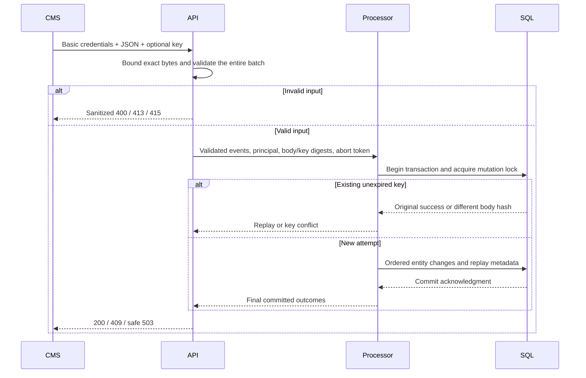

# Synchronous CMS webhook

`POST /cms/events` is implemented under the CMS Basic scheme. The [API contract](api.md#post-cmsevents) describes every field, response, limit, and retry rule. [Consumer endpoints](consumers.md) are implemented; [operational health, telemetry, and request limits](operations.md) are implemented.

## Request lifecycle

The diagram's successful mutation path assumes commit is acknowledged. Conflicts and precommit failures roll back; an uncertain commit returns a conservative error without claiming rollback. See the [SQL protocol](persistence.md#failure-and-deadline-behavior) for cancellation and response-loss details.

## Code organization

| Location | Responsibility |
| --- | --- |
| Api/Cms/Controllers | Authentication policy, HTTP response mapping, and safe trace correlation |
| Api/Cms/Dtos | Transport envelope and final response DTOs |
| Api/Cms/Services | Bounded body reading, representation/header checks, and exact-byte preservation |
| Api/Cms/Validation | Complete-document checks, internal validation result, and collected expected field errors before domain construction |
| Api/Documentation | Generated OpenAPI request/schema refinements and Basic security metadata |
| Api/ErrorHandling | Shared sanitized JSON problem writing, including derived validation error maps |
| Application/Processing | Existing request-bound transaction/replay orchestration; independent of HTTP |

MVC explicitly discovers the internal CMS controller through ApiControllerFeatureProvider. This keeps application/domain contracts internal within the selected single production assembly. Normal public test-controller discovery remains isolated to the test host. The controller uses constructor injection; it does not locate storage services through HttpContext.

## Validation and confidentiality

Read at most one MiB plus one detection byte, even without Content-Length. Validate the whole array before opening SQL, including malformed UTF-8, Unicode escapes, unknown envelope names, duplicate names anywhere, depth/count bounds, positive int64 versions, IDs, object payloads, and explicitly zoned timestamps. Seven fractional timestamp digits match .NET/SQL precision; excess precision is rejected. Expected invalid inputs produce collected errors rather than domain exceptions. Domain invariant guards remain the last defensive boundary.

Envelope fields are case-sensitive; action names are case-insensitive. Arbitrary valid payload values remain intact, including large integers and HTML strings. Clients rendering HTML remain responsible for safe rendering; this API does not claim to sanitize rich HTML for display. Raw bodies are retained only during request reading/validation and are hashed without reserialization. Persistence retains only current snapshots and successful metadata as documented in the SQL guide.

Logs report safe validation counts, trace IDs, processing classifications, event positions, and confirmed outcomes. They exclude credentials, source IDs, key values, payloads, SQL messages, and exception objects. Responses carry no-store and safe correlated Problem Details, even for unsupported Accept headers. HTTP abortion is propagated; no success is written while commit is pending.

## OpenAPI and Postman

Any configured account may retrieve `/openapi/v1.json`; business operation schemes remain separate. The generated document includes implemented routes only, response DTOs, the strict envelope/conditional content schema, optional key header, and safe response codes. It uses ASP.NET Core's [OpenAPI transformers](https://learn.microsoft.com/en-us/aspnet/core/fundamentals/openapi/customize-openapi?view=aspnetcore-10.0) because ingestion deliberately reads exact bytes before typed construction. Microsoft.OpenApi is pinned to patched 2.7.5 to retain vulnerability auditing; see the [upstream advisory](https://github.com/advisories/GHSA-v5pm-xwqc-g5wc).

The [Postman walkthrough](postman/README.md) provides executable synthetic ingestion, replay/conflict, validation, duplicate, deletion, and documentation requests. Templates contain no credentials. The collection now includes reader/admin state checks and local disabling.

## Verification boundaries

Unit tests cover accepted size/count/depth boundaries, content preservation, mixed-case actions, offsets/precision, optional delete fields, invalid Unicode keys, and invalid UTF-8. HTTP cases exercise the production authorization policy, strict validation, unsupported media/encoding, unknown-length size enforcement, safe errors, and generated documentation without requiring SQL.

Real HTTP/SQL cases verify committed state immediately after 200, unseen-revision unpublishing, full rollback on a later conflict, complete prevalidation, exact scoped replay across host restart, concurrent identical/different bodies, commit-before-response, cancellation, deadlines, lock/storage failures, and a fault after a real commit. Failure probes live only in the test assembly. A lost-acknowledgment probe does not claim all network/OS crash scenarios; hosted CI and actual execution evidence are reported separately in the PR.
